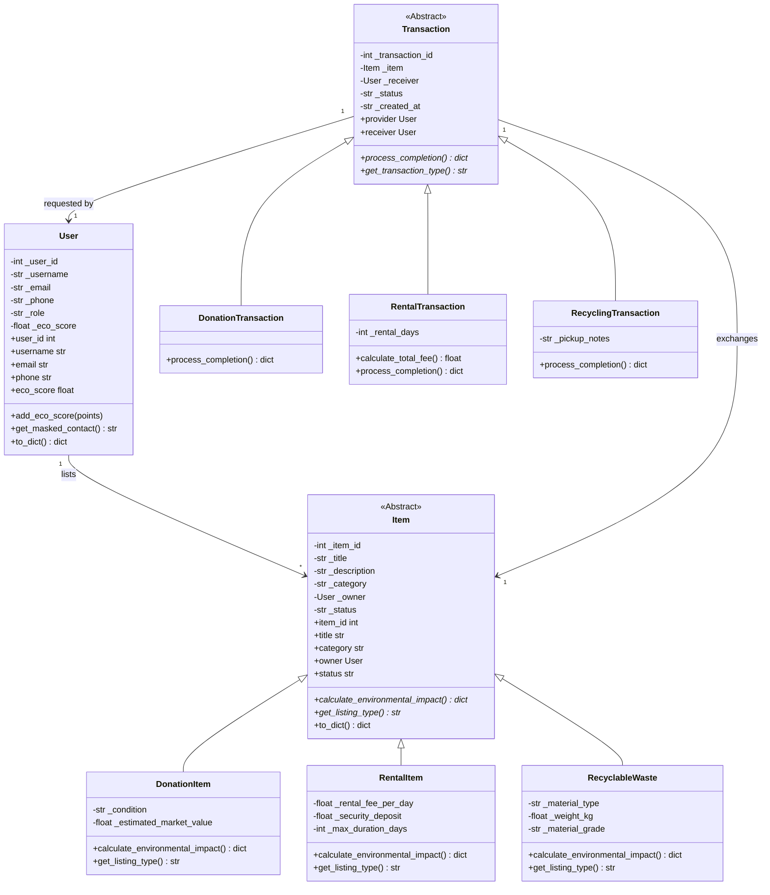

# EcoShare: Community Resource & Waste Exchange Platform

[](https://sdgs.un.org/goals/goal11)
[](https://sdgs.un.org/goals/goal12)
[](https://python.org)
[](https://fastapi.tiangolo.com)
[](https://pytest.org)

> **EcoShare** is a circular economy and campus resource exchange platform designed for an **Object-Oriented Programming (OOP) Lab / Viva**. It targets urban overconsumption and municipal waste reduction by enabling campus residents to share equipment, donate surplus books/appliances, and dispatch recyclables.

---

## 🏛️ How OOP Principles Map Directly to EcoShare

| OOP Pillar | Design & Implementation in EcoShare | File Reference |
| :--- | :--- | :--- |
| **Encapsulation** | Sensitive attributes (`_email`, `_phone`, `_eco_score`) protected with leading underscores. Validated via `@property` getters/setters (regex email checks, phone lengths). Contact masking method `get_masked_contact()` preserves privacy. | [`app/models/user.py`](app/models/user.py) |
| **Inheritance** | Base abstract class `Item` encapsulates universal listing attributes (`id`, `title`, `category`, `owner`, `status`). Specialized subclasses `DonationItem`, `RentalItem`, and `RecyclableWaste` inherit and extend state. | [`app/models/item.py`](app/models/item.py) |
| **Polymorphism** | Abstract method `calculate_environmental_impact()` implemented with distinct scientific formulas across each item subclass (avoided manufacturing CO2, tool lifecycle extension, mass-based landfill diversion). | [`app/models/item.py`](app/models/item.py) |
| **Abstraction** | Interfaces defined using Python's `abc.ABC` module (`Transaction`, `NotificationService`). Concrete implementations swap channels or execute exchange state transitions without exposing lower-level SQL or transport logic. | [`app/models/transaction.py`](app/models/transaction.py), [`app/services/notification.py`](app/services/notification.py) |

### Design Patterns Demonstrated
1. **Factory Method (`ItemFactory`)**: Standardizes dynamic instantiation of concrete `Item` subclasses from web form payloads without coupling controllers to constructors.
2. **Singleton (`DatabaseManager`)**: Ensures a single unified SQLite connection pool and lazy schema bootstrap.
3. **Strategy / Observer (`NotificationService`)**: In-memory event logger decoupling state changes from message dispatching.

---

## 📊 High-Level Architecture (UML Class Diagram)



---

## 🌍 UN Sustainable Development Goals (SDGs) Alignment

EcoShare maps directly to two key UN 2030 Global Goals:

### 1. SDG 11: Sustainable Cities and Communities
- **Target 11.6**: *"By 2030, reduce the adverse per capita environmental impact of cities, including by paying special attention to municipal and other waste management."*
- **Platform Contribution**: EcoShare enables localized campus communities and housing blocks to divert solid cardboard, plastics, and electronics into certified circular supply chains rather than urban dumpsites.

### 2. SDG 12: Responsible Consumption and Production
- **Target 12.5**: *"By 2030, substantially reduce waste generation through prevention, reduction, recycling and reuse."*
- **Target 12.2**: *"Achieve the sustainable management and efficient use of natural resources."*
- **Platform Contribution**: The tool sharing/rental model implements a **Product-as-a-Service (PaaS)** model, multiplying equipment utility rates and drastically cutting redundant personal purchases of rarely used power tools.

---

## 🚀 Quickstart & Setup Guide

### 1. Prerequisites
- Python 3.10+ installed

### 2. Run Test Suite (Pytest)
Validate all OOP design patterns, inheritance, polymorphism, and encapsulation constraints:
```powershell
python -m pytest -v
```

### 3. Launch Web Application
```powershell
python -m uvicorn app.main:app --reload
```
Open your browser at **`http://127.0.0.1:8000`** to interact with the UI, test listings, complete transactions, and view the live SDG Impact dashboard.

---

## 📁 Repository Structure

```text
ecoshare/
├── app/
│   ├── models/
│   │   ├── __init__.py
│   │   ├── user.py          # Encapsulation & validation
│   │   ├── item.py          # Abstract Base Item, Inheritance & Polymorphism
│   │   └── transaction.py   # Abstract Transaction & Completion strategies
│   ├── services/
│   │   ├── __init__.py
│   │   ├── item_factory.py  # Factory Pattern implementation
│   │   ├── impact_service.py# Polymorphic impact aggregations
│   │   └── notification.py  # Abstraction & In-memory notification service
│   ├── database/
│   │   ├── __init__.py
│   │   └── db_manager.py    # Singleton SQLite persistence layer
│   ├── templates/           # Clean responsive Tailwind templates
│   │   ├── base.html
│   │   ├── index.html       # Marketplace grid & live metrics
│   │   ├── list_item.html   # Dynamic polymorphic listing form
│   │   ├── request_item.html# Exchange initiator
│   │   ├── transactions.html# State transitions & notifications
│   │   ├── impact.html      # SDG 11 & 12 analytics dashboard
│   │   └── viva.html        # Comprehensive Viva Defense Guide
│   └── main.py              # FastAPI controller
├── tests/
│   └── test_oop_core.py     # Unit test suite verifying all 4 OOP pillars
├── requirements.txt
└── README.md
```
